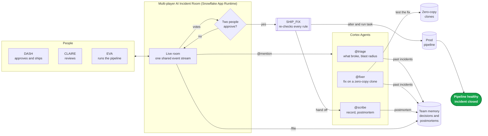

# Multi-player AI Incident Room

AI is single-player by default. Incidents aren't. This sample puts the whole team and three Cortex Agents in one live room when a pipeline breaks, all inside Snowflake.

- **@triage** finds what broke, when, and the blast radius (from Snowflake lineage). Read-only.
- **@fixer** writes a fix and proves it on a **zero-copy clone**. It cannot touch prod.
- **@scribe** keeps the record and files a blameless postmortem.

Everyone in the room sees every message, tool call, and evidence card as it happens. Opening a room pages @triage automatically. @mention one agent, or use `@all` to run them in parallel.

Agents do the legwork. People decide: nothing reaches prod until **two people vote yes**. Agents can't vote, and anyone can pull the **andon cord** to stop every agent and block shipping. The decisions outlive the chat, so the next incident starts from the last fix.

## How it works



- **One room, many people:** each browser opens a server-sent event stream. Every message, tool call, and vote goes through one bus, and is also written to `INCIDENT_ROOM.APP.EVENTS`, so a reload replays the room.
- **Identity:** when deployed, the app reads the signed-in Snowflake user from the ingress header. Votes are attributed to real users.
- **Agents see the room:** each agent gets the room transcript. When deployed, each agent keeps one Cortex thread per incident (id stored in `INCIDENTS.THREADS`), so later turns send only what's new.

## Team memory

- **`/file <decision>`:** records a decision the team made, for example "the AMOUNT_USD rename is permanent". It lands as an attributed, append-only row in `INCIDENT_ROOM.APP.DECISIONS`, along with who was in the room.
- **`/file` on its own:** @scribe drafts the decisions made since the last filing and files them on behalf of whoever asked.
- **Across incidents:** @triage and @fixer call `PAST_INCIDENTS`, which returns earlier decisions and postmortems. A repeat failure starts from the last fix instead of from scratch. @scribe quotes filed decisions in the postmortem.

## How it stays safe

| Role | Can do | Can't do |
|---|---|---|
| `INCIDENT_ROOM_AGENT` (pinned when the app calls an agent) | Run the three agents and their tools | Anything else, including `SHIP_FIX` |
| `INCIDENT_ROOM_OPS` (owns the agent tools) | Read the demo pipeline, read lineage, create objects only in `INCIDENT_ROOM_CLONES` | Change prod |
| `INCIDENT_ROOM_SHIPPER` (owns the prod task and `SHIP_FIX`) | Change the task, but only through `SHIP_FIX` | — |

`SHIP_FIX` is the real gate, and it lives in the database. Before it alters the task, it re-checks that:

- the patch passed on the clone;
- the room isn't frozen;
- there are at least two distinct human approvals and no rejections (`IR_REQUIRED_APPROVALS` in `app.yml` can raise that, never lower it);
- the person shipping approved;
- if `APPROVER_ROLE` is set, the approvers and the shipper hold that role;
- the SQL is a single INSERT inside the pipeline's schema.

The app checks the same rules first (`lib/domain/`) only to give fast feedback. `SHIP_FIX` trusts the voter names the app records: it stops agents and bad SQL, not a compromised app identity.

**Caller's rights on approvals:** when deployed, approving and shipping also open the voter's own Snowflake session. The session user must match the room identity. Anyone can still reject.

**Requiring an approver role:** set `APPROVER_ROLE` at the top of `SHIP_FIX` in `sql/ship.sql` and re-run that file. The database then counts only approvals from users who hold the role, directly or through other roles, and only a holder can ship. Set `IR_APPROVER_ROLE` to the same role under `environment_variables` in `app.yml` so the app refuses earlier, with a clearer message.

## Prerequisites

- **Snowflake account:** Cortex Agents and Snowflake App Runtime must be available. If your region doesn't host the agents' model, enable cross-region inference: `ALTER ACCOUNT SET CORTEX_ENABLED_CROSS_REGION = 'ANY_REGION';`
- **ACCOUNTADMIN:** run setup, deploy and the demo scripts with a connection that can use ACCOUNTADMIN. The scripts switch to it, and the app relies on it inheriting `INCIDENT_ROOM_AGENT` and `INCIDENT_ROOM_SHIPPER`.
- **[Snowflake CLI](https://docs.snowflake.com/en/developer-guide/snowflake-cli/index)** 3.32 or later (for `snow app deploy` with `app.yml` version 2), with a connection to that account (`snow connection add`).
- **Node.js** 22 or later.

## Setup

```bash
./setup.sh <connection>
```

This runs, in order: `setup.sql` (roles, warehouse, demo pipeline, clone sandbox, room tables), `sql/tools.sql`, `sql/ship.sql`, `sql/agents.sql`, `demo/reset_memory.sql` (one past incident, so @triage has something to remember), and `demo/reset.sql` (original task body, a healthy run of the load, no open rooms). It takes a few minutes and is safe to re-run at any point.

Then deploy the app:

```bash
snow app deploy --connection <connection>
```

The command prints the app URL. To let teammates in, grant their role usage on the app, then send them the link (or use the **Invite** button in a room):

```sql
GRANT USAGE ON DATABASE INCIDENT_ROOM TO ROLE <team_role>;
GRANT USAGE ON SCHEMA INCIDENT_ROOM.APP TO ROLE <team_role>;
GRANT USAGE ON APPLICATION SERVICE INCIDENT_ROOM.APP.INCIDENT_ROOM_APP TO ROLE <team_role>;
```

> The vote needs **two different Snowflake users** when deployed. To try it alone, run locally (below) and use the `dev: be DASH CLAIRE EVA` links, one per browser.

## Run the demo

1. `snow sql --connection <connection> -f demo/break.sql`. The upstream team renames `RAW_ORDERS.AMOUNT` to `ORDER_AMOUNT`, and `LOAD_DAILY_REVENUE` fails.
2. Open the app. The failure shows under **Failing on the line**. Click **Open a room**. @triage reports the cause and blast radius, and says it has seen this once before (the seeded incident).
3. Click **Invite** and bring in a teammate.
4. Say `@fixer propose a fix and prove it on a clone`. The clone test lands on the board, and the room moves to **Up for a vote**.
5. Pull **Andon**: votes and agents are blocked. Clear it.
6. Two people approve. Someone who didn't approve tries to ship and is refused. An approver clicks **Ship to prod**. The task is updated and runs.
7. Type `/file the ORDER_AMOUNT rename is permanent`, or just `/file` to let @scribe draft it.
8. Shipping hands off to @scribe, which writes and files the postmortem on its own. Read it in the room.
9. `snow sql --connection <connection> -f demo/reset.sql` puts the pipeline back and clears the rooms. It keeps the team's memory, so break it again and @triage cites what you just filed. To reset memory to the single seeded incident, run `demo/reset_memory.sql`.

## Local development

```bash
npm install
SNOWFLAKE_DEFAULT_CONNECTION_NAME=<connection> npm run dev
```

- **Playing several teammates:** use the `dev: be DASH CLAIRE EVA` links in the room header, one per browser.
- **Agents locally** run through `SNOWFLAKE.CORTEX.DATA_AGENT_RUN` with your connection's role. Replies arrive whole rather than streamed, and there are no threads, so each call sends the full room transcript.
- **Agents when deployed** use the [Cortex Agent SDK](https://www.npmjs.com/package/@snowflake/cortex-agent-sdk) (`@snowflake/cortex-agent-sdk`), streamed, with one Cortex thread per agent per incident and the service token pinned to `INCIDENT_ROOM_AGENT`.
- **Environment:** unset `SNOWFLAKE_USER` and `SNOWFLAKE_PASSWORD` if they're exported for another account, because the SDK prefers them over the connection.

## Tests

```bash
npm test                                                             # no Snowflake needed
IR_CONTRACT=1 IR_CONNECTION=<connection> npx vitest run __tests__/contract  # the real tools on Snowflake
```

The contract tests run `demo/reset.sql` before and after, which clears every room, so don't run them during a live demo.

## Layout

```
setup.sh, setup.sql, sql/   Snowflake objects, tools, SHIP_FIX, agents
demo/                       break.sql, reset.sql, reset_memory.sql
lib/domain/                 rules: incident state, votes, andon, patch guard, evidence, room view (pure, tested)
lib/agents/                 run an agent (Cortex Agents REST with threads, or DATA_AGENT_RUN locally)
lib/room/                   in-memory bus, store (INCIDENT_ROOM.APP), service (orchestration)
lib/sar-sdk/, lib/snowflake.ts   Snowflake connection for the app (deployed service token or local connection)
app/, components/room/      home (failures, incidents) and the live room
__tests__/                  unit tests; contract/ runs the real tools (opt-in)
```

## Clean up

```sql
USE ROLE ACCOUNTADMIN;
DROP APPLICATION SERVICE IF EXISTS INCIDENT_ROOM.APP.INCIDENT_ROOM_APP;
DROP DATABASE IF EXISTS INCIDENT_ROOM;
DROP DATABASE IF EXISTS INCIDENT_ROOM_DEMO;
DROP DATABASE IF EXISTS INCIDENT_ROOM_CLONES;
DROP WAREHOUSE IF EXISTS INCIDENT_ROOM_WH;
DROP ROLE IF EXISTS INCIDENT_ROOM_AGENT;
DROP ROLE IF EXISTS INCIDENT_ROOM_OPS;
DROP ROLE IF EXISTS INCIDENT_ROOM_SHIPPER;
```

## Known limits

- **One instance:** the app runs as a single instance (`max_instances: 1`), because the live bus is in memory.
- **Narrow demo scope:** the tools watch one schema (`INCIDENT_ROOM_DEMO.SALES`) and one task. Pointing them elsewhere means changing the constants in `sql/tools.sql` and `sql/ship.sql`.
- **Fixed names:** the warehouse `INCIDENT_ROOM_WH` is named in `setup.sql`, `sql/agents.sql` and `app.yml`. The task's schedule never fires, because it stays suspended and the demo runs it with `EXECUTE TASK`.

## Exercises: try these with CoCo

- **Watch your own pipeline:** point the tools and `SHIP_FIX` at a real schema, task, or dynamic table.
- **Page the room from Slack:** have an alert on task failures open a room and post the link.
- **Fix more kinds of breakage:** let @fixer handle dynamic tables (`CREATE OR REPLACE DYNAMIC TABLE` on the clone) as well as tasks.
- **Add a fourth agent:** for example @reviewer, which checks a patch against data-quality metrics before the vote opens.
- **Keep the decisions searchable:** put a Cortex Search service over `DECISIONS` and `POSTMORTEMS` so `PAST_INCIDENTS` finds related incidents by meaning, not just by the task that failed.
